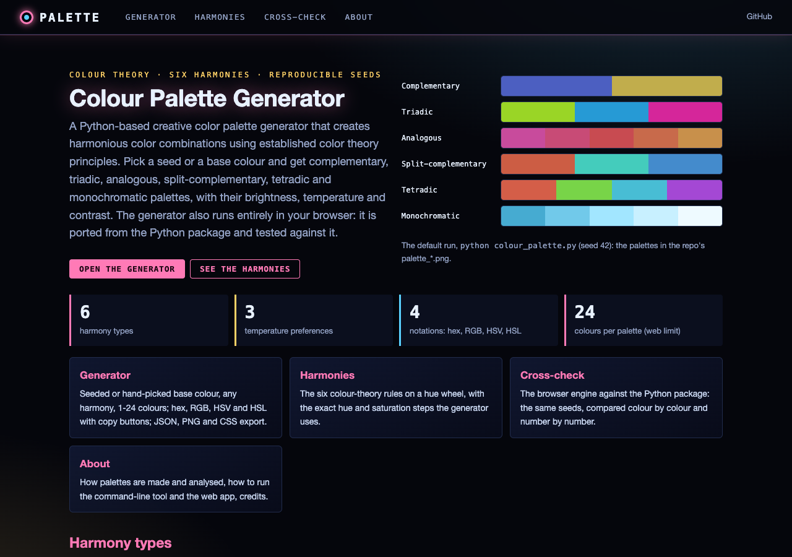
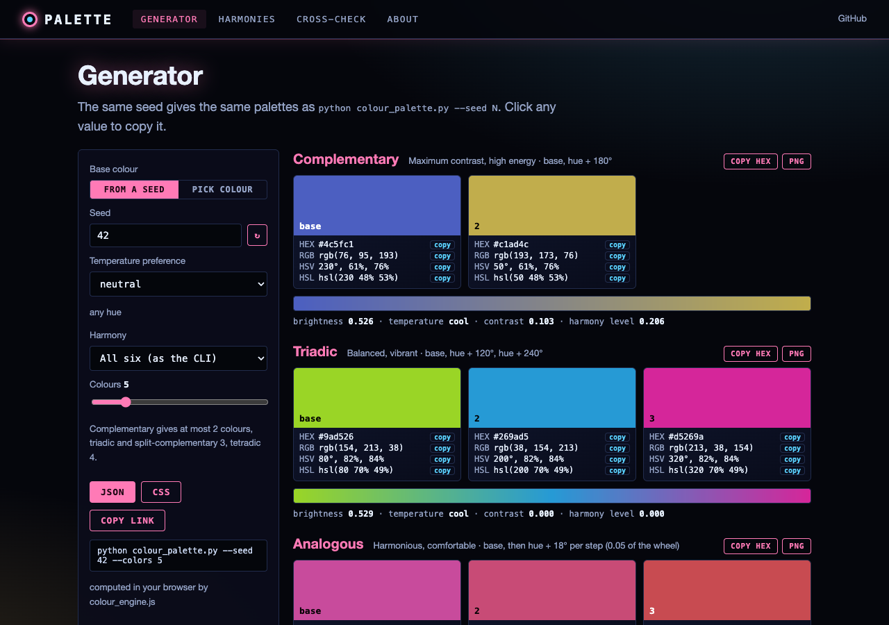
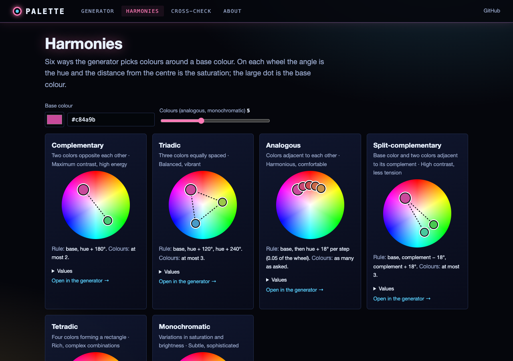

# Color Palette Generator

A Python-based creative color palette generator that creates harmonious color combinations using established color theory principles. The generator produces both visual representations and detailed color data, perfect for designers, artists, and developers.

## Features

- **Multiple Harmony Types**:
  - Complementary (two colors opposite each other)
  - Triadic (three colors equally spaced)
  - Analogous (colors adjacent to each other)
  - Split-complementary (base color and two colors adjacent to its complement)
  - Tetradic (four colors forming a rectangle)
  - Monochromatic (variations in saturation and brightness)

- **Advanced Color Analysis**:
  - Color temperature calculation
  - Brightness analysis
  - Contrast (range between the lightest and darkest swatch)
  - Harmony level (a simple score: twice the contrast, capped at 1)

- **Rich Visualizations**:
  - Color blocks with RGB/Hex information
  - Smooth gradient transitions
  - Comprehensive color data display

- **Multiple Output Formats**:
  - PNG visualizations
  - JSON data export
  - RGB/HSV/Hex color codes

## Installation

1. Clone this repository:
```bash
git clone https://github.com/gddickinson/colour-palette.git
cd colour-palette
```

2. Install required dependencies:
```bash
pip install -r requirements.txt
```

## Usage

### Basic Usage

Generate palettes for all harmony types:

```bash
python colour_palette.py
```

Options: `--seed N` (default 42), `--harmony {complementary,triadic,analogous,split_complementary,tetradic,monochromatic}`
(default: all six), `--colors N` (default 5) and `--output-dir DIR` (default `.`). The committed `palette_*.png` and
`palette_data.json` are the output of the default run (seed 42).

This will:
1. Create visualization files for each harmony type (`palette_*.png`)
2. Save complete palette data (`palette_data.json`)
3. Print progress information

### Programmatic Usage

```python
from colour_palette import Color, ColorPaletteGenerator, HarmonyType
from colour_palette.visualizer import visualize_palette

# Create generator with optional seed
generator = ColorPaletteGenerator(seed=42)

# Generate a specific palette
palette_data = generator.generate_palette(
    temperature="neutral",
    harmony_type=HarmonyType.COMPLEMENTARY,
    num_colors=5
)

# Create visualization
colors = [Color(h, s, v) for h, s, v in palette_data["hsv_values"]]
visualize_palette(
    colors,
    title="Custom Palette",
    filename="custom_palette.png"
)
```

## Output Files

### PNG Visualizations
- Separate files for each harmony type
- Shows color blocks with RGB/Hex values
- Includes gradient transitions
- Names format: `palette_[harmony_type].png`

### JSON Data
- Complete palette information in `palette_data.json` (RGB/hex rounded to 0-255, so hex codes round-trip)
- Includes for each palette:
  - Hex color codes
  - RGB values
  - HSV values
  - Color analysis
  - Harmony type
  - Temperature characteristics

## Color Theory Implementation

### Temperature Control
- Warm colors: Reds, oranges, yellows
- Cool colors: Blues, greens, purples
- Neutral: Full spectrum available

### Harmony Rules
- **Complementary**: Maximum contrast, high energy
- **Triadic**: Balanced, vibrant
- **Analogous**: Harmonious, comfortable
- **Split-complementary**: High contrast, less tension
- **Tetradic**: Rich, complex combinations
- **Monochromatic**: Subtle, sophisticated

## Customization

### Modifying Color Generation

```python
# Custom temperature preference
palette = generator.generate_palette(temperature="warm")

# Specific number of colors
palette = generator.generate_palette(num_colors=3)

# Custom harmony type
palette = generator.generate_palette(
    harmony_type=HarmonyType.TRIADIC
)
```

### Adjusting Visualization

```python
visualize_palette(
    colors,
    title="Custom Title",
    filename="custom_name.png"
)
```

## Analysis Features

The generator provides detailed analysis of each palette:

- **Brightness**: mean of (R + G + B) / 3 over the swatches (0-1)
- **Temperature**: "warm" if the mean of (R - B) is positive, else "cool"
- **Contrast**: brightest minus darkest swatch brightness
- **Harmony**: min(1, 2 x contrast)

Note that complementary palettes have at most 2 colours, triadic and split-complementary 3, and tetradic 4, whatever
`num_colors` is; analogous and monochromatic use `num_colors`. The temperature preference (`warm`, `cool`, `neutral`)
is available from Python (`generate_palette(temperature=...)`), not as a CLI option.

## Web interface and static site

The generator also runs in a browser: **https://gddickinson.github.io/colour-palette/** (published from `main` by
`.github/workflows/pages.yml`). Pick a seed (the same seed gives the same palettes as `python colour_palette.py
--seed N`) or a base colour, any harmony and 1-24 colours, and get hex / RGB / HSV / HSL values with copy buttons,
the analysis and the gradient strip, plus JSON (`palette_data.json` format), PNG and CSS export. Other pages show the
six harmonies on a hue wheel and cross-check the browser engine against the Python package.





Run the web app locally (palettes then come from the Python package, and the matplotlib PNG is available):

```bash
pip install -r requirements-web.txt
python run_web.py          # http://127.0.0.1:8150
python -m pytest -q tests/test_web.py test_colour_palette.py
python scripts/build_static.py --out site   # the static site
```

The static site uses `colour_palette/web/static/colour_engine.js`, a JavaScript port of `color.py` and `generator.py`
including Python's Mersenne Twister seeding and `colorsys`. `node colour_palette/web/static/colour_engine.test.mjs`
compares it with reference values computed by the Python code (`scripts/make_engine_fixture.py` writes
`tests/fixtures/colour_engine.json`); all of them are bit-identical.

## Contributing

Areas for potential enhancement:

- Additional harmony types
- More color theory metrics
- Enhanced visualization options
- Color accessibility analysis
- Pattern generation

## License

This project is licensed under the MIT License - see the LICENSE file for details.

## Acknowledgments

- Built using numpy and matplotlib
- Color theory principles from traditional art and design
- HSV color space calculations for intuitive color manipulation


---
*Built with AI assistance from [Claude (Anthropic)](https://claude.com/).*
